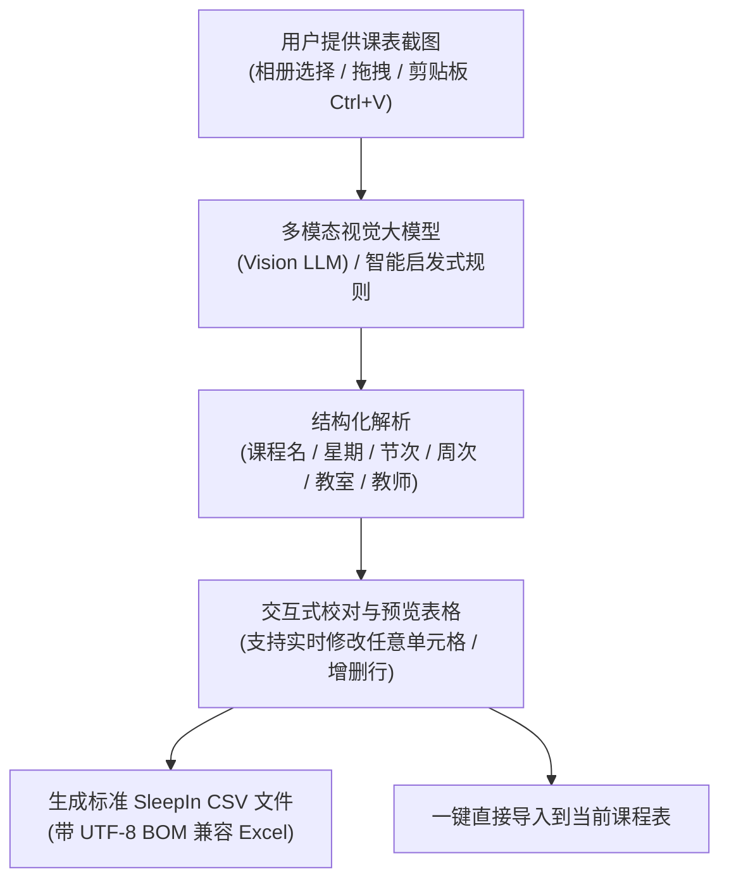

# SleepIn - 现代高校课程表与作息提醒系统

<p align="center">
  
</p>

<p align="center">
  <strong>高校课程表管理 · 科学作息管理 · 课程提醒 · 课表截图转 CSV · 纯前端 PWA 跨平台</strong>
</p>

<p align="center">
  <a href="https://github.com/tanijasafuha4-dev/SleepIn">
    
  </a>
  <a href="https://github.com/tanijasafuha4-dev/SleepIn/actions">
    
  </a>
  <a href="./LICENSE">
    
  </a>
</p>

---

## 📖 项目简介

**SleepIn** 是一款专为高校大学生打造的高颜值、现代化的课程表与作息管理应用。本项目包含两个完整的端实现：

1. **`android-source/`**：原开源安卓客户端源码，基于 Kotlin、Jetpack Compose、Room 本地数据库与 Material Design 3 架构。
2. **`web-app/`**：全新重构的**纯前端静态网页应用（PWA）**，零后端依赖，可直接部署在 **GitHub Pages** 上，完美适配 **手机端触屏手势** 与 **iPhone 灵动岛 / 刘海屏安全区域**，支持在 iOS Safari 中“添加到主屏幕”作为独立全屏 App 运行！

---

## ✨ 核心功能亮点

- 📅 **智能周课表**：自动按学期开学日期推算当前周次（精确展示“第 X 周 · 当前为第 Y 周”），直观状态横幅提示（学期未开始/已结束）。
- 👆 **触屏手势交互**：支持手机端左右滑动手势无缝切换上/下一周，顺滑流畅。
- 🕒 **实时作息红线**：根据当前时间在今日日程中实时计算并投射红色时刻指示线，直观掌握下节课进度。
- 📚 **多课程表 & 专属作息表**：支持同时管理多个学期课程表与独立作息时间规范，自由切换激活。
- ⚡ **一键智能生成作息**：输入第一节上课时间、单节课时、课间休息时长和总节数，自动秒级排定全天课节。
- 🛡️ **课程时间冲突检测**：智能排查同星期、时间段交叉以及周次重叠（单周/双周/连续周/自选周），提供冲突明细拦截与强制保存选项。
- 🔔 **课程提醒与舒缓音效**：支持提前 5~30 分钟提醒，内置精细调校的二和弦铃声（支持 Web Audio API 零延迟本地合成与音频播放），支持系统通知栏与动态灵动岛（Fluid Cloud）胶囊提示。
- 💾 **无服务器纯本地存储**：基于浏览器 `IndexedDB` 与 `localStorage` 双重持久化存储，离线可用，隐私完全属于用户。
- 📊 **标准 CSV 与完整备份**：支持标准 CSV 课表与作息表导入导出，支持整库 JSON 一键备份与恢复。
- 📸 **课表截图智能转 CSV**：全新加入的高校课表截图与文本智能解析转换器！

---

## 📸 核心突破：课表截图转 CSV（原理与实现方案）

针对广大同学“教务系统课表无法直接导出 CSV、手动逐门录入极其繁琐”的痛点，本项目在 `web-app` 中落地了 **课表截图智能转 CSV 工具**。

### 1. 这一步的技术原理与全流程设计



### 2. 为什么选用多模态视觉方案与 Cloudflare Gemini 反代？
- **传统 OCR 的局限**：国内各高校教务系统（正方、强智、青果、URP 等）截图排版差异极大，常常出现多节连堂合并单元格、无明显网格线、单双周格式杂乱（如 `1-16(单)`、`3-15周`、`[01-02节]`）。传统 OCR + 固定正则切分经常发生单元格错位与漏行。
- **视觉大模型（Vision LLM）的优势**：利用 Gemini 视觉大模型对复杂二维表格的深层空间结构理解能力，配合专有的视觉结构化 Prompt，直接输出 100% 符合规范的结构化 JSON。
- **免用户填写配置（内置 Cloudflare 反代）**：
  - 前端已默认接入您的 Cloudflare Gemini 反向代理服务：`https://my-free-ai.ccwu.cc/v1/chat/completions`。
  - 默认模型设定为：`gemini-3.5-flash-lite`。
  - **普通用户体验**：访问网站无需输入任何 API Key 或反代网址，上传截图后直接点击“开始智能解析”即可秒级完成！
  - **站长配置变量**：在 `web-app/js/config.js` 中提供 `DEFAULT_API_KEY` 变量，您只需填入您的 API Key，即可供所有访客直接使用；或者在 Cloudflare Worker 的后台环境变量中设置 `GEMINI_API_KEY`，实现服务端静默鉴权。

### 3. 使用方法
1. 在网页端点击 **“📸 课表截图转 CSV”** 按钮。
2. **选择截图**：可以直接点击上传，或者在网页窗口中直接按 **`Ctrl+V`** 粘贴剪贴板里的课表截图。
3. **识别与提取**：
   - **方式 A（一键 AI 识别，推荐）**：无需任何配置，直接点击“开始智能解析截图”，系统通过内置的 `my-free-ai.ccwu.cc` 反代与 `gemini-3.5-flash-lite` 模型秒级完成识别。
   - **方式 B（教务文本智能提取）**：直接从教务系统网页全选复制课表文字，粘贴到文本框中点击“智能提取”。
   - **高级自定义（可选）**：如需使用自己的私有 API Key 或其他 OpenAI 兼容端点，可展开“自定义接口 / 专属 Key 变量”修改。
4. **校对与导出**：
   - 界面立即渲染出直观的可编辑校对表格，确认无误后可点击 **“💾 导出为标准 CSV 文件”**（可分享给他人导入）或 **“📥 直接导入到当前课表”**！

---

## 🛡️ 开源安全与 API Key 保护机制

本项目完全开源在 GitHub，**严禁将真实的 API Key 直接提交到代码仓库中**（否则会被 GitHub 密钥扫描机器人检测并自动撤销作废）。为此我们内置了安全、纯静态的本地持久化机制：

1. **设备端本地持久化记忆（推荐）**：
   - 用户在网页“自定义接口 / 专属 Key 变量”输入框填入一次 `AQ.` 密钥后，前端会自动将其安全保存在该设备的浏览器 `localStorage` 中。
   - 绝不经过任何第三方，无论刷新页面、关闭浏览器、还是添加到 iPhone 主屏幕全屏运行，均自动读取，无需反复填写。
2. **开源代码零泄露风险**：
   - 代码库中 `web-app/js/config.js` 的 `DEFAULT_API_KEY` 默认留空，所有个人密钥仅存在于用户自己的设备本地，保证 100% 安全合规。

## ☁️ 关于 Cloudflare 与反代服务说明

1. **为什么 Cloudflare 显示“不能将变量添加到只有静态资产的 Worker”？**
   - 如果在 Cloudflare 部署的是静态前端页面（Workers with Static Assets），Cloudflare 仅将其作为 CDN 静态分发，没有动态 Node.js/V8 服务端运行时，因此管理面板会锁定“运行时变量”。
2. **反向代理网站 `my-free-ai.ccwu.cc`**：
   - 您的反向代理已经稳定运行，接收标准的 OpenAI 格式请求并转换为 Google Gemini REST API (`v1beta`)。
   - 前端已彻底移除此前未填 Key 时发送的占位头，保持请求头干净；无论通过请求头携带 Key 还是通过反代默认鉴权，均能完美识别！


## 🚀 GitHub Pages 在线部署与使用指南

本项目的 `web-app` 目录是一个**纯前端静态网页工程**，无须安装 Node.js 后端服务器，只要有 HTTP 静态托管即可全球秒开：

### 1. 启用 GitHub Pages 服务
1. 进入本仓库的 **Settings** -> 侧边栏 **Pages**。
2. 在 **Build and deployment** 下：
   - **Source** 选择：`Deploy from a branch`。
   - **Branch** 选择：`main`（或 `master`），目录选择 `/web-app`。
3. 点击 **Save** 保存，等待约 1 分钟即可生成专属在线链接：
   ```text
   https://<你的GitHub用户名>.github.io/SleepIn/
   ```

### 2. 本地快速预览
如果您想在本地电脑测试，可在项目根目录运行任意静态文件服务，例如：
```bash
# 使用 npx 启动静态服务
npx serve web-app

# 或使用 Python 快速启动
python -m http.server 8080 --directory web-app
```
打开浏览器访问 `http://localhost:8080` 即可。

---

## 📲 在 iPhone 上全屏使用（添加到主屏幕）

本项目深度适配了 iOS Safari 的 PWA 规范与 iPhone 硬件特性：

1. 在 iPhone 上打开 **Safari 浏览器**，访问部署后的 GitHub Pages 网址。
2. 点击 Safari 底部工具栏正中间的 **“分享”** 按钮（方框带向上箭头图标）。
3. 向上滑动分享菜单，点击 **“添加到主屏幕”**（Add to Home Screen）。
4. 在右上角点击 **“添加”**。
5. 返回 iPhone 桌面，即可看到漂亮的 **SleepIn** 图标！
6. **全屏沉浸体验**：点击图标启动后，无浏览器上下地址栏，自动适配 **灵动岛（Dynamic Island）**、**刘海屏** 与 **底部手势指示条**，与原生 iOS App 体验完全一致！

---

## 📂 项目结构全览

```text
another-sleepin/
├── AGENTS.md                  # 常驻自动化与开发准则
├── README.md                  # 本项目总说明文档
├── android-source/            # 原开源安卓项目完整源码
│   ├── app/                   # Android App 模块 (Kotlin / Jetpack Compose / Room)
│   ├── docs/                  # 原项目设计与开发文档
│   └── build.gradle.kts       # Gradle 构建配置
└── web-app/                   # 纯前端静态网页版 (PWA)
    ├── index.html             # 单页应用入口 (含 PWA 与 iPhone 安全区域 Meta)
    ├── manifest.json          # Web App 清单文件
    ├── sw.js                  # Service Worker 离线缓存脚本
    ├── css/
    │   └── style.css          # Material Design 3 设计体系与移动端适配样式
    ├── js/
    │   ├── app.js             # 主应用状态协调器 (MVVM)
    │   ├── db.js              # IndexedDB 本地持久化与默认数据播种
    │   ├── csv.js             # 课程表/作息表 CSV 编解码与导入导出引擎
    │   ├── ocr-parser.js      # 课表截图视觉识别与文本提取解析器
    │   ├── conflict.js        # 课程时间冲突检测算法
    │   ├── reminder.js        # 课程闹钟提醒与二和弦提示音引擎
    │   └── theme.js           # 深浅色主题与 Material 调色板管理
    ├── assets/
    │   ├── audio/             # 课程提醒音频资源 (reminder.wav)
    │   └── images/            # Logo 与宣传图
    └── icons/                 # PWA 高清图标与 Apple Touch Icon
```

---

## 📄 开源许可

本项目遵循开源许可证规范，保留原项目开源署名：
- 原 Android 项目源自：[Kurosu-Ti01/SleepIn](https://github.com/Kurosu-Ti01/SleepIn)
- Web 重构版及截图转 CSV 扩展由开源社区共同维护，欢迎提交 Issue 与 Pull Request！
